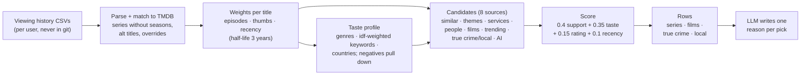

# LLM watch recommender

Personal series and film recommendations from your own streaming-service viewing history (Netflix, Prime and others),
combining a transparent content-based recommender on TMDB with an LLM for extra candidates and one-line reasons.
Every change is measured with a **time-split backtest**, and the LLM's jobs are benchmarked across models and
reasoning efforts.

- `recommender/recommend.py`: history → taste profile → candidates from 8 sources → score → rows, with LLM reasons.
- `recommender/evaluate.py`: the backtest: replay history at earlier dates and score what was watched afterwards.
- `recommender/bench_models.py`: compare LLM models and reasoning efforts on the three AI jobs.
- `recommender/netflix_import.py`: thumbs and abandoned titles from a Netflix data request.
- `tests/`: parsing, weights, metrics, and a full `build()` against a fake TMDB (no keys needed).

## How it works



**Signals.** A series weighs `1 + log2(1 + episodes)` (max 6); a film 2 to 4, depending on how much the user watches
films. A loved title adds 2, liked 1, being on their list 1. Thumbs-down and titles abandoned within minutes weigh 0,
are never suggested, and pull their genres and keywords down. Every weight decays with a 3-year half-life (floor
a quarter): tastes drift.

**Candidates.** TMDB's recommendations and similar titles of the 60 strongest titles are the workhorse. Seven more
sources cover tastes TMDB's lists miss: discover on the user's most distinctive keywords ("themes"), popular titles
on the services in their history, other work of the creators and lead actors of their favourites, well-rated films in
their strongest genres, trending titles, true crime and local titles (only if that is ≥ 4 % of their viewing), and
~20 free-form LLM suggestions resolved on TMDB.

**Score.** `support` = how many of their titles point to a candidate, log-scaled against the strongest candidate
and damped by popularity (popular titles sit in everyone's TMDB lists); `taste` = keyword and genre fit;
`rating` and `recency` as small tie-breakers.

**The LLM explains, the score picks.** The LLM writes one short reason per title, in one or more languages
(`REASON_LANGS`). Letting the LLM pick the rows itself (`REC_LLM_MODE=pick`) is supported, but the backtest showed it
picks worse than the score (below).

## Evaluation: a time-split backtest

`evaluate.py` replays each user's history up to two cutoffs: the dates by which 75 % and 85 % of their dated history
was watched. The recommender only sees what came before; watchlists are left out (undated, they would leak later
intent). The **truth** is every title first watched after the cutoff (not abandoned, not thumbs-down). It reports
hits, precision and recall at 12/24/48, **pool coverage** (the share of the truth that is a candidate at all), and
per candidate source the share of the truth it brings in, and the share *only* it brings in. Baselines: the same pool
sorted by popularity, and optionally the previous version of the code (`OLD=`).

### Results (three real users, October 2026)

| User (history) | Truth after cutoff | Precision@12 | Popularity baseline | Pool coverage |
|---|---|---|---|---|
| A (~6,900 views over years) | 208 / 144 titles | **38–42 %** (4.5–5 of 12) | 0 % | 17 % |
| B (~1,450 views, mostly older) | 73 / 48 | 4 % | 8 % | 16 % (was 4 %) |
| C (~100 views) | 13 / 12 | 0 % | 0 % | 8 % |

- With a long history it works: for user A, 5 of the top 12 were titles they really watched later; popularity alone
  found none.
- **The bottleneck is coverage, not ranking**: most of what people watch later isn't in TMDB's "similar" lists of what
  they watched. Adding the extra sources lifted user B's coverage from 4 % to 16 %, mostly through "themes".
- **The LLM explains better than it picks**: for user A, the score's ranking reached 38 % P@12, the page's rows 25 %,
  and the LLM's own picks 12 %. So the score picks and orders every row, and the LLM only writes the reasons.
- **Ablation** for user A: more anchors (35 → 60) raised P@12 from 25 % to 42 %; a larger scored pool (220 → 400)
  raised coverage from 12 % to 17 % at no cost to the ranking.

**Caveat:** small numbers. User A's 42 % is about 5 of 12; for B and C half a hit is noise. Solid: user A against the
popularity baseline (hits in every variant against 0), and the parsing gains, which were measured directly.

## Benchmark: which model for which job

`bench_models.py` runs the three AI jobs on the same time split (2 users × 2 cutoffs = 4 runs per config).
Amounts are in euros, converted from OpenRouter's billing in US dollars at 0.86.

| Config | Cost (4 runs) | Candidates: hits (no other source) | Pick: hits@12 | Reasons |
|---|---|---|---|---|
| Gemini 3.7 Flash | €0.18 | 8 (6) | 6 | 100 % covered, all within limits |
| GPT-6 Luna, low effort | €0.012 | 5 (3) | 8 | 100 %, all within limits |
| **GPT-6 Luna, medium (chosen for reasons)** | **€0.015** | 8 (4) | 6 | 100 %, 2 % over 90 characters |
| GPT-6 Luna, xhigh | €0.029 | 8 (4) | 6 | 100 %, all within limits |

For the candidates job alone (where a smarter model could help):

| Config | € per call | Hits (no other source) | Per year (3 users, weekly) |
|---|---|---|---|
| GPT-6 Sol, max effort | 0.031 | **14 (8)** | ~€4.90 |
| Claude Opus 5.5 | 0.026 | 12 (8) | ~€4.00 |
| DeepSeek V4.1 Flash, high | 0.003 | 10 (7) | ~€0.45 |
| GPT-6 Luna, medium | 0.0007 | 8–10 (4–6) | ~€0.10 |

- The same model varies 2–5 hits between runs, so only the larger model stood out (+3–4 hits).
- The replay flatters the AI: it knows which older titles became hits after the cutoff. Compare configs with each
  other, not with the TMDB sources.
- Defaults: GPT-6 Luna (medium) for the reasons, DeepSeek V4.1 Flash (high) for the candidates: the most consistent
  cheap model, at about €0.45 a year.

## Running it

```sh
pip install -r requirements.txt
cp .env.example .env                        # TMDB_API_KEY; optional OPENROUTER_KEY_FILE
mkdir -p history/alice                      # put alice's exports here: netflix-history.csv, prime-history.csv, ...
python3 recommender/recommend.py alice      # -> data/alice/index.html, recommendations.json, unmatched.txt
python3 recommender/evaluate.py             # backtest every user in history/
JOBS=reasons CONFIGS="openai/gpt-6-luna:medium" python3 recommender/bench_models.py
python3 -m unittest discover tests
```

Settings (environment): `REGION`, `TMDB_LANGUAGE`, `LOCAL_COUNTRY`, `REASON_LANGS`, `REC_LLM_MODEL`, `REC_LLM_EFFORT`,
`REC_CAND_MODEL`, `REC_CAND_EFFORT`, `REC_LLM_MODE`, `REC_AI_CANDIDATES`, `REC_ANCHORS`, `REC_POOL`, `REC_POP_DAMP`.
Per user: `history/<user>/prefs.json` (`exclude`: anime, animation, kids; `persona` for the prompts) and
`overrides.csv` (`Title,tmdb` with `tv:<id>`, `movie:<id>` or `skip`) for titles that match wrongly.

**Privacy:** the viewing history stays on your machine. Only titles go to TMDB and the LLM; never commit `history/`.

## License

MIT. Data and images: [TMDB](https://www.themoviedb.org/) (this product uses the TMDB API but is not endorsed or
certified by TMDB).
